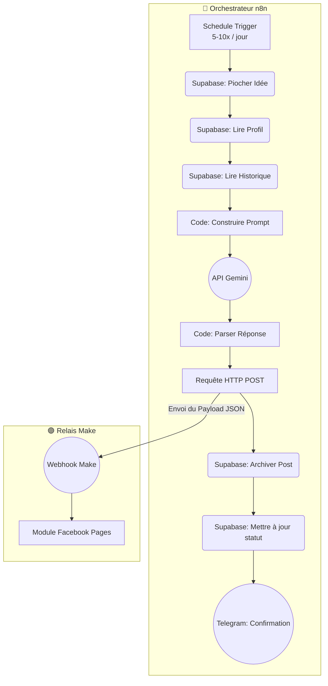
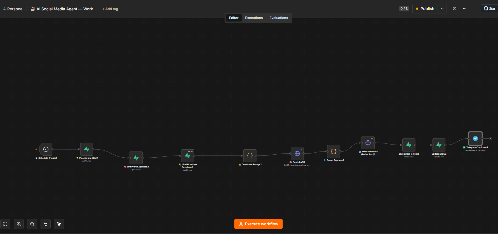
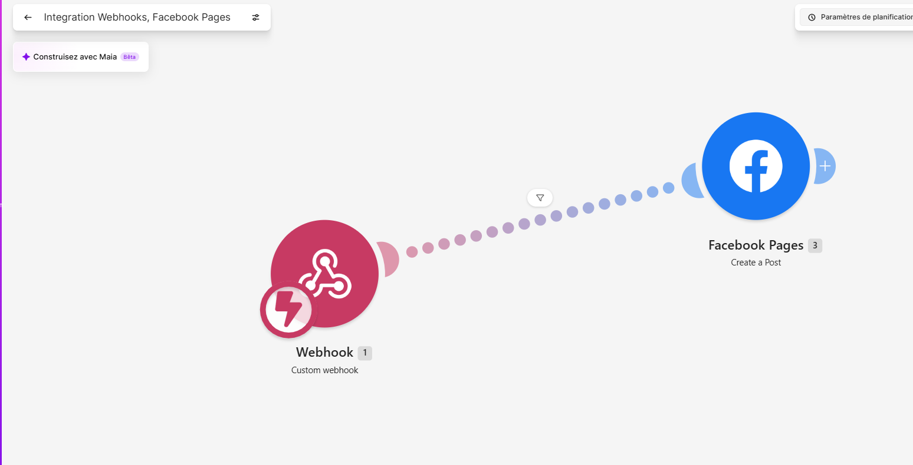

# n8n AI Social Media Agent

Agent autonome n8n qui génère et publie du contenu sur Facebook via Gemini, Supabase et Make.

## 🚀 Fonctionnalités

* **Pilotage Data-Driven** : Base de données Supabase pour stocker les profils, historiques et idées de posts.
* **Génération IA Avancée** : Utilisation de l'API Google Gemini avec un prompt ingénierie complexe pour garantir un ton naturel et éviter le spam.
* **Publication Automatisée (via Make)** : Connexion à un scénario Make dédié pour interagir avec l'API Facebook Pages et contourner les restrictions d'automatisation.
* **Monitoring Telegram** : Notifications automatiques pour confirmer les publications.

## 📐 Architecture

## 🛠️ Stack Technique

| Technologie | Usage |
| :--- | :--- |
| **n8n** | Orchestration du workflow principal et préparation des données |
| **Supabase** | Base de données (Idées, Profil, Historique) |
| **Google Gemini API** | Génération du texte structuré |
| **Make** | Réception du Webhook n8n et publication officielle sur Facebook |
| **Telegram API** | Alerting & Logs |

## 🏁 Démarrage Rapide

1. Clonez ce dépôt ou téléchargez les fichiers JSON.
2. Créez un fichier `.env` basé sur le modèle `.env.example` fourni.
3. Importez le `workflow.json` dans votre instance n8n.
4. Importez le blueprint `make-blueprint.json` dans Make pour créer le relais de publication.
5. Consultez `docs/installation.md` pour connecter les deux outils.

## 📸 Screenshots

* **Capture n8n** :  
  
* **Capture Make** :  
  

## 📚 Documentation

* [Guide d'Installation](docs/installation.md)
* [Architecture & Flux](docs/architecture.md)
* [Nœuds utilisés](docs/nodes.md)
* [Format des données et Webhooks](docs/webhooks.md)
* [Limitations & Roadmap](docs/roadmap.md)
* [Schéma de Données Supabase](docs/database.md)

## ⚠️ Avertissements de Sécurité

> [!CAUTION]
> L'automatisation agressive sur les réseaux sociaux (Facebook, LinkedIn) peut entraîner des pénalités ou des bannissements de compte. Assurez-vous de respecter les CGU des plateformes. **Ne commitez jamais vos clés d'API.**

## 🤝 Contribuer

Nous acceptons les Pull Requests ! Veuillez lire le [CONTRIBUTING.md](CONTRIBUTING.md) pour les détails sur notre code de conduite et le processus de soumission.

## 👤 Auteur

* **Nombré Alidou Salim**

## 📄 Licence

Ce projet est sous licence **MIT**. Voir le fichier [LICENSE](LICENSE) pour plus de détails.
