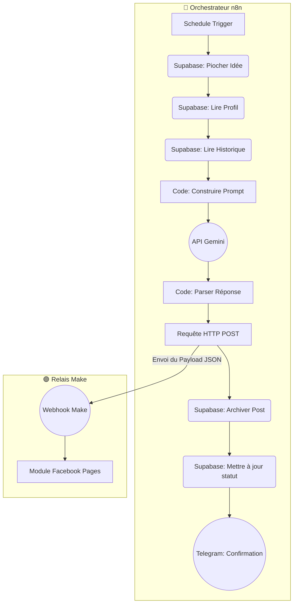

# Architecture et Flux

Ce workflow est divisé en deux parties : un orchestrateur principal sur n8n et un relais de publication sur Make.

## 📐 Diagramme Détaillé

## 📝 Explication des étapes

* **Trigger n8n** : Déclenche le workflow automatiquement toutes les 3 heures.
* **Contexte (n8n)** : Agglomère les directives marketing (**Profil**), le sujet du post (**Idées**) et les 5 derniers posts (**Historique** pour éviter les répétitions).
* **IA (n8n)** : Demande à **Gemini** de rédiger le post sous forme de JSON strict. Le nœud de code JavaScript nettoie ensuite les éventuels artefacts de texte.
* **Passerelle (n8n vers Make)** : Le texte validé est transmis au Webhook de Make via une requête HTTP POST.
* **Publication officielle (Make)** : **Make** reçoit le texte et s'occupe de la publication sur la page Facebook via l'API officielle.
* **Clôture (n8n)** : **n8n** archive le post en base de données (**Supabase**) et notifie l'administrateur sur **Telegram** avec un message de confirmation.
